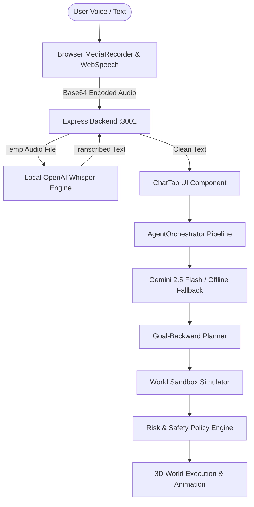

# SentinelHome: Architecture Document

## 1. System Overview
SentinelHome is an autonomous smart-home reasoning platform integrating 3D procedural simulation (Three.js/R3F), multi-agent human behavioral simulation, a 6-stage reasoning pipeline, and multimodal voice input with local OpenAI Whisper STT and Gemini LLM.



---

## 2. Voice Input & STT Subsystem Architecture

### 2.1 Audio Ingestion Contract
- **Client**: `ChatTab.tsx` uses `navigator.mediaDevices.getUserMedia({ audio: true })` and `MediaRecorder`.
- **MIME Types Supported**: `audio/webm;codecs=opus`, `audio/webm`, `audio/mp4`, `audio/ogg`, `audio/wav`.
- **Transmission**: Data URL / Base64 payload transmitted via `POST /api/voice/transcribe`.
- **Payload Schema**:
  ```json
  {
    "audio": "data:audio/webm;codecs=opus;base64,GkXfo..."
  }
  ```

### 2.2 Server-Side Transcription Pipeline
1. **Base64 Sanitization**: Parse MIME type and strip data URL prefix using robust separator splitting (`audio.split(',')[1]`).
2. **Buffer Validation**: Enforce minimum buffer size threshold (1KB) to reject truncated or empty microphone clicks.
3. **Container Matching**: Match temporary file extension to the audio MIME type (`.webm`, `.mp4`, `.wav`) to prevent demuxer failures in ffmpeg.
4. **Whisper Worker (`server/transcribe.py`)**:
   - Invokes OpenAI Whisper (`base` model, fp16=False on CPU).
   - Captures any ffmpeg warnings and writes structured JSON to `stdout`.
   - On error, emits structured JSON to `stdout` AND diagnostic traceback to `stderr`.
5. **Cleanup**: Guarantee temporary file unlink in `finally` blocks.
6. **Fallback Mechanism**: If local Whisper is unavailable or errors, frontend seamlessly utilizes Web Speech API (`SpeechRecognition`) transcripts.

---

## 3. Security & Safety Boundaries
- **No Remote Leaks**: Voice audio is processed 100% locally on the host machine via Whisper. No audio data leaves the local network.
- **Payload Limits**: Express body parser restricted to 25MB with strict timeout guards.
- **Safety Invariant Enforcement**: All transcribed utterances are subjected to the 8 Core Safety Rules and Pool Water Safety Invariants before any device state changes.
