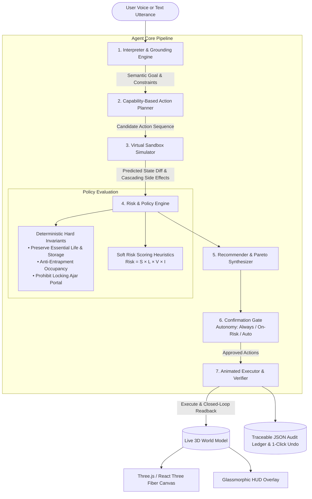

# SentinelHome: Autonomous 3D Smart-Home Simulator & Safety Engine

SentinelHome is a sandboxed, browser-based 3D smart-home simulator powered by an autonomous contextual AI Agent.
Unlike standard voice assistants (which simply map rigid triggers to device toggles), SentinelHome uses a formal **World Model**, a multi-stage **Reasoning & Policy Pipeline**, and a **Predictive Simulation Sandbox** to assess real-world context, foresee cascading consequences, enforce safety & invariant policies, propose safer plans, request approval, and execute with closed-loop verification.

Everything runs in a simulated 3D environment with procedural geometry, physical collision boundaries, multiple autonomous and user-controlled people, real working animated doors/locks, and responsive device states.

---

## Architecture Overview



---

## Key Features

1. **Procedural 3D Modern Residence**:
   - 7 architectural zones: Main Hall, Bedroom, Bathroom, Kitchen, Garage, Terrace, Lawn & Garden.
   - 100% procedural geometry (RoundedBox, PBR materials, warm palette, wood, tile, marble, and concrete). Zero external textures/models required; runs completely offline.
   - Dynamic cutaway roof and wall auto-fading in Top View and Room Inspector.
   - Physically animated hinged doors with electronic locks, status LEDs, and bathroom privacy latch.

2. **Inhabitant Simulation & Physics**:
   - Multiple procedural humanoids: **You** (adult, user-controlled), **Grandpa** (elderly, high vulnerability, autonomous wanderer), and **Kid** (child). Support for adding guests and custom inhabitants.
   - Continuous wall and furniture collision detection.
   - Walkable open doors; interact with `E` key.
   - Scripted NPC routines (e.g. *"Grandpa stays in Bathroom"*).
   - Real-time per-frame room occupancy tracking engine.

3. **Multi-Camera Tactical Views**:
   - **Mode 1: Person View**: First-person perspective from avatar's eye height (smooth mouse look, FOV slider, tactical radar minimap).
   - **Mode 2: Room View**: Room-by-room inspector with corner camera cycling, device status, and occupant badges.
   - **Mode 3: Top View**: Orthographic architectural floor plan with cutaway roof, occupant colored markers, and lock status glyphs.
   - **Mode 4: Orbit View**: Free orbital camera with smooth tweening and pan/tilt/zoom.

4. **10-Module Agent Architecture**:
   - **World Model**: Single source of truth with live state and declarative device capability schema.
   - **Interpreter**: LLM structured JSON output (Gemini 2.5 Flash) via backend proxy, with an offline rule-based NLP parser.
   - **Planner**: Derives actions from device capabilities (not hardcoded recipes) and orders topologically by physical dependencies (close door before locking, stop stove before lights).
   - **Simulator**: Virtual sandbox clone that detects cascading effects (e.g. cutting main breaker disconnects refrigerator, cameras, and medical vital monitor).
   - **Risk & Policy Engine**: Deterministic dual-layer safety engine.
   - **Recommender**: Generates Pareto-optimal safe plan, substitutes safe modifications (e.g. dim light for elderly rather than blackout), and offers 3 plan alternatives.
   - **Confirmation Gate**: Autonomy gating (`Ask Always`, `Ask on Risk`, `Auto Safe`).
   - **Executor & Verifier**: Sequenced execution with 3D animation, telemetry readback, and automated rollback if post-conditions fail.
   - **Memory & Adaptation**: Preference memory learning from simulation history (e.g., preserving hall nightlight for Grandpa) and editable runtime rule editor.
   - **Explainer & Audit Log**: Collapsible 6-stage stepper (Understand > Simulate > Analyze > Recommend > Confirm > Execute/Verify) with JSON export and single-click Reversible Undo.

---

## Safety Policy & Invariants Matrix

### Deterministic Hard Invariants (Never Overridden)
| Invariant ID | Rule Name | Description | Violation Consequence |
|---|---|---|---|
| `invariant_preserve_essential` | Preserve Essential Power | Under no circumstances can power be cut to devices tagged as `ESSENTIAL` (Refrigerator, Vital Monitors, Main Breaker). | **STRICTLY BLOCKED** |
| `invariant_no_lock_ajar` | Prohibit Locking Open Door | Smart deadbolts cannot engage while the door leaf is open or obstructed. | **STRICTLY BLOCKED** |
| `invariant_anti_entrapment` | Anti-Entrapment Occupancy | Doors cannot be locked from the outside while occupants are inside that room. | **STRICTLY BLOCKED** |

### Soft Risk Scoring Formula
$$\text{Risk Score} = \text{Severity} \times \text{Likelihood} \times \text{Vulnerability} \times \text{Irreversibility}$$

- **Severity**: `LOW` (1), `MEDIUM` (2), `HIGH` (3), `CRITICAL` (4)
- **Likelihood**: 0.1 to 1.0 (e.g. 0.9 for unattended stove, 0.6 for nighttime unlocked doors)
- **Vulnerability**: Inhabitant vulnerability score (Adult = 0.1, Kid = 0.75, Grandpa = 0.9)
- **Irreversibility**: `IMMEDIATE` (1.0), `MEDIUM` (1.5), `IRREVERSIBLE` (2.5)

---

## Adding New Devices & Rules Dynamically

### 1. Register a New Device Type
Adding a new device type requires **zero agent core code changes**. Simply register a schema in `DeviceTypeRegistry`:

```typescript
import { DeviceTypeRegistry } from './src/agent/WorldModel';

DeviceTypeRegistry.register({
  type: 'air_purifier',
  criticality: 'COMFORT',
  actions: {
    turn_on: {
      name: 'Activate HEPA Filter',
      description: 'Cleans air particulate and allergens',
      preconditions: { power: 'off' },
      effects: { power: 'on' },
      reversibility: 'IMMEDIATE',
    },
    turn_off: {
      name: 'Deactivate HEPA Filter',
      description: 'Powers down fan',
      preconditions: { power: 'on' },
      effects: { power: 'off' },
      reversibility: 'IMMEDIATE',
    },
  },
});
```

### 2. Define a New Safety Rule
Rules can be added in `initialWorld.ts` or dynamically edited at runtime in the **Rules & Memory** UI tab:

```typescript
{
  id: 'rule_custom_pool_gate',
  name: 'Pool Gate Child Safety',
  description: 'Never leave gate unlocked when a child is in the yard.',
  enabled: true,
  severity: 'CRITICAL',
  conditionType: 'custom',
  explanation: 'Unattended pool portal presents a critical drowning risk for minors.',
  suggestedFix: 'Engage safety latch immediately.'
}
```

---

## Getting Started

### 1. Prerequisites
- Node.js (v18+)
- npm

### 2. Installation
```bash
git clone <repo-url>
cd Smart_home
npm install
```

### 3. Environment Setup (Optional for Cloud LLM)
Copy `.env.example` to `.env`:
```bash
cp .env.example .env
```
Add your `GEMINI_API_KEY`:
```ini
PORT=3001
GEMINI_API_KEY=your_gemini_api_key_here
```
> **Note**: If `GEMINI_API_KEY` is not provided, SentinelHome automatically runs in high-capability **Offline Fallback Mode** with deterministic keyword/synonym intent extraction. The API key is kept exclusively on the server and is never bundled in browser code.

### 4. Running the Application
```bash
npm run dev
```
Open [http://localhost:5176](http://localhost:5176) in your browser.

---

## Keyboard Controls & Hotkeys

| Key | Action |
|---|---|
| `1` | **Person View** (First-person eyes + Tactical Minimap) |
| `2` | **Room View** (Room Inspector with corner camera) |
| `3` | **Top View** (Orthographic 3D architectural floorplan) |
| `4` | **Orbit View** (Free orbit & tilt around residence) |
| `W / A / S / D` | Walk active avatar (continuous collision detection) |
| `Q / E` | Rotate avatar camera yaw |
| `E` | Open / Close nearest interactive door |
| `?` | Toggle Keyboard Shortcuts Legend |

---

## Verification & Testing Suite

SentinelHome includes a comprehensive test suite executed via Vitest and `fast-check`:

1. **Hard Invariant Unit Tests** (`tests/invariants.test.ts`):
   - Asserts essential devices (fridge, breaker, medical monitor) cannot have power cut.
   - Asserts doors with occupants inside cannot be locked from outside.
   - Asserts open doors cannot engage smart deadbolts.
2. **Property-Based Testing** (`tests/property_based.test.ts`):
   - Uses `fast-check` to run 100+ randomized home topologies, randomized occupant room placements, and random command permutations.
3. **25+ Scenario Verification Suite** (`tests/scenario_suite.test.ts`):
   - Leaving home, Goodnight, Cozy mode, Cooking mode, Grandpa power preservation, Safety status audits, Vague commands, Mispronounced commands and typos, Child voice safeguards, Adversarial bypass prompt attempts, Sleeping occupants, Reversibility & Undo, and Dynamic new device registration.

Run the test suite:
```bash
npm test
```
All 33 test suites pass cleanly.
